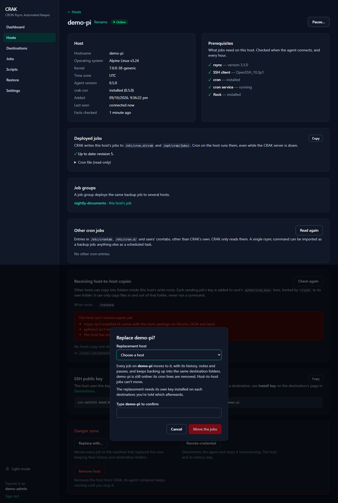
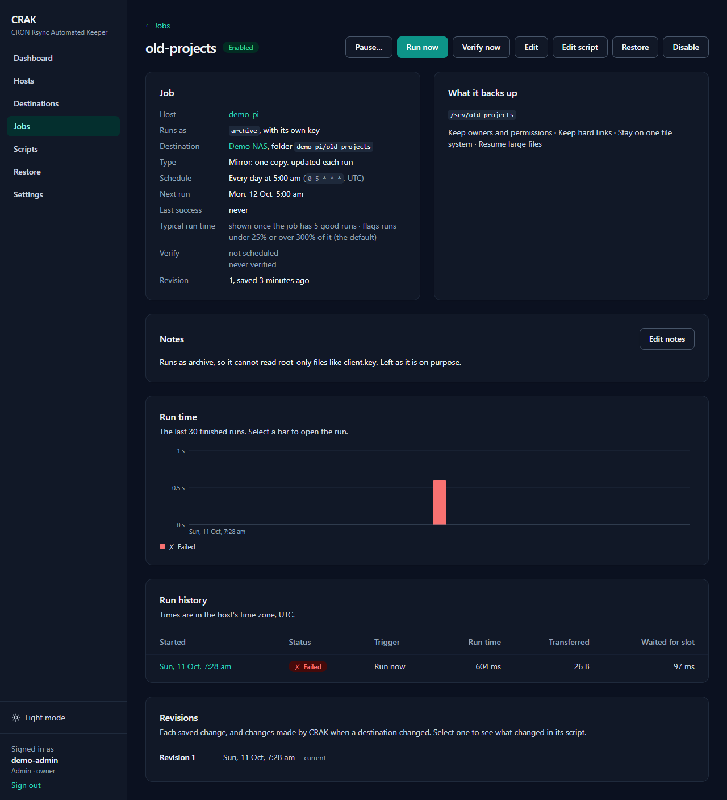

# CRAK: CRON Rsync Automated Keeper

**CRAK is a web UI for backups across all your machines.** Set up your backups once in the browser, and CRAK puts them into each machine's own cron, collects every result, and tells you when something goes wrong. Backups are plain files that rsync writes, so you can still browse them with `ls` if you ever stop using CRAK.

If you run a few Linux boxes and a NAS, you probably have rsync scripts in cron somewhere, a few of them failing silently. CRAK keeps the scripts on each machine (so backups still run when CRAK is down), and gives you one place to see every backup, every result and every restore.

These screenshots come from a test setup with made-up hosts (`demo-web`, `demo-pi`, `demo-nas`), a made-up destination (`Demo NAS`) and made-up data. They're from CRAK **0.5.1**, in dark mode (the default).

---

## The pitch in one screen

- **Backups run from cron on each machine**, not from the CRAK server. So they keep running even when CRAK is down.
- **CRAK does the boring bits**: it builds the rsync commands, writes the cron lines, copies them to each host, and keeps the history.
- **Nothing is locked in.** Each job is a readable shell script on its host, and the backups are ordinary folders on the destination.
- **You can see everything in one place**: every run, its result in plain words, its log, and every alert.

---

## Features

### Backup jobs
- Build a job in the browser: tick folders in a tree, pick a host and a destination, and see the exact script and cron line before you save.
- **Mirror** (one copy, updated each run) or **snapshots** (a dated copy each run, hard-linked so unchanged files take no extra space, with retention per job or in Settings).
- **Run as** another user on the host, with that user's own SSH key.
- **Before and after steps**, such as stopping containers for a consistent copy.
- **Notes** on each job, shown on its page and written as comments in the host's cron file.
- **Dry run** shows what would be copied, changed or deleted. It writes nothing except the job's empty folder on the destination.
- **Job groups** back up the same folder on several hosts with one definition, starting them a few minutes apart.
- **Host-to-host** copies, one-way, into a folder on another host.
- **Pause** a job, a host, a destination, a group or everything: for 1, 4 or 24 hours, until you resume, or until a time you choose.

### Scheduled tasks and the script library
- A library of scripts with versions, variables and defaults.
- Built-in templates for PostgreSQL, MySQL/MariaDB, SQLite and Docker volume dumps.
- A scheduled task is a script plus its values, and runs from cron on the host like any other job.
- **Import** existing cron jobs, including their scripts, as jobs or tasks.

### Monitoring and alerts
- Every run has a result, statistics, and a searchable log you can download. A failure says what went wrong, in plain words.
- Run-time history per job, and a flag for runs that are much quicker or slower than usual.
- **Verify** compares a backup with its source by checksum, on demand or on a schedule, and reports damaged files.
- Alerts for backups that failed, didn't run, were lost, or are damaged; hosts that are offline; destinations that can't be reached; and a job whose "run as" user is missing.
- Discord notifications, and Prometheus metrics at `/metrics`.

### Restore
- Pick the host a backup came from, the job, and the copy (a snapshot or the mirror).
- Browse the backup where the files were on the original machine, and tick what you want back.
- Restore in place, into another folder, or **onto another host**, such as the machine that replaced a dead one.
- A dry run first, and overwriting existing files is off by default. A restore never deletes anything.

### Hosts and destinations
- Add a host with a compose file and a one-time token. CRAK shows what each host is ready for (rsync, SSH, cron, flock).
- A destination is any machine with SSH and rsync, such as a NAS. CRAK doesn't need to be installed on it.
- **Install key** once per host (the password is typed once, never stored), then **Test connection** checks login, rsync, write access, hard links, free space and extended attributes.
- **Replace with…** moves a dead host's jobs to its replacement, with their history, notes, pauses and destination folders.

### Operations and settings
- **Settings** in four groups: backups, notifications and alerts, integrations (Prometheus, export and import), and the account (password and audit log).
- **YAML export and import** of jobs, groups, destinations and scripts, so a job set can live in Git.
- **CRAK backs itself up**, on a schedule, to a destination you choose.
- **Audit log** of changes and sign-ins, with who made them and from where, kept for a year.
- A single admin login, meant for a private network.

---

## How it works

It's a few pieces working together:

1. **The CRAK server** runs the web UI and keeps the database. It has no backup work of its own.
2. **An agent** runs on every machine you want to back up. It reports the machine's status, and it puts CRAK's jobs into that machine's cron.
3. **Cron on each machine** runs the jobs on schedule. It works even if the CRAK server is down.
4. **Each run** writes its result and log back to the server, which shows them in the history and raises alerts when something needs attention.
5. **Destinations** are the NAS or other machine where the backups are stored. They just need SSH and rsync.

Every change goes through the server, which sends it to the agent. CRAK never runs arbitrary commands on your machines: the agent only does a fixed set of actions, such as running a job, testing a destination, or installing a key.

---

## The demo

### Dashboard

One page for "is anything on fire?": hosts online, open alerts, jobs whose last run went wrong, every run of the last 30 days, and each job's last result and next run.

### Hosts

Every machine running the CRAK agent, with its status, OS, agent version, and how many jobs are deployed.

Each host shows what it's ready for, the cron file and job scripts CRAK has put on it, and any cron jobs CRAK didn't create. Those can be imported with one click.

**Replace with…** moves every job to the machine that replaced a dead one. The jobs keep their history, notes, pauses and destination folders, so the backups carry on where they were.

### Destinations

Install a key once per host, then **Test connection** checks everything a backup needs.

### Backup jobs

Each job has its own page with what it backs up, its schedule and next run, its notes, a run-time chart, the full run history, and every revision of its script. **Run now**, **Verify now**, **Restore** and **Pause** are at the top.

Snapshot jobs list the snapshot each run made.

**Pause…** stops a job's scheduled runs until you resume it. **Run now** still works while paused.

The builder has a live preview. You tick folders in a tree, choose the switches (each showing the rsync flag it turns on), and **What will run** shows the exact script and cron line, with the next runs, before anything is saved.

Every job's script is readable. If you tweak it by hand, CRAK keeps a revision for each change.

### Job groups

One backup definition on several hosts, starting a few minutes apart so they don't all hit the NAS at once. Editing the group updates every host's copy.

### Scheduled tasks and scripts

A library of reusable scripts, with built-in templates for database dumps.

Each script has versions, variables with defaults, and a preview of exactly what a task will run.

A scheduled task is a script plus its values, with its own run history.

### Run results

Every run has a result, statistics, and the full log, which you can search or download.

A job running as `archive` can't read a root-only file. The run names the file and says what to do, instead of leaving you to decode exit code 23.

If a job's "run as" user doesn't exist on its host, CRAK holds that one job back, raises an alert, and shows why at the top of the job page. The host's other jobs still deploy.

### Restore

Pick the host, the job and the copy, then tick what to restore from the tree of where the files were.

**Restore to** can be another machine, such as the replacement for a dead one. That machine reads the backup with its own key, and the page warns if the key isn't on the destination yet.

### Settings

Four groups: backups, notifications and alerts, integrations (Prometheus, export and import), and the account (password and audit log).

---

## What it isn't

- **Not a backup format.** The backups are plain folders on your destination, so you don't need CRAK to read them.
- **Not for other platforms.** The server and agents are Linux amd64 only.
- **Not for the internet.** It's meant for a private network, with one admin login.
